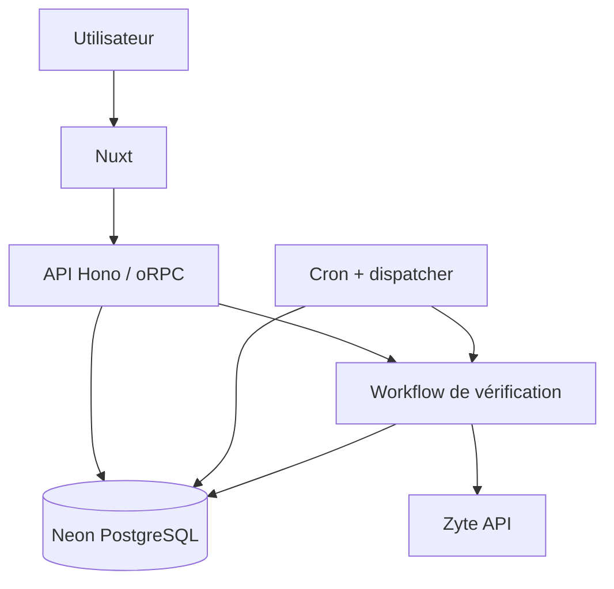

# Alba — État du projet et suivi d’avancement

> **Mise à jour :** 22 novembre 2026  
> **Phase :** infrastructure B02 déployée sur dev ; contrats B03 implémentés et testés localement
>
> **Statut général :** monorepo compilé et testé ; trois Workers et un Workflow déployés sur dev ; contrats métier versionnés disponibles
>
> **Objectif immédiat :** implémenter Neon B04 et Zyte B05 pour la première vérification durable.

## 1. Présentation du projet

**Alba** permet à un utilisateur d’enregistrer une URL de fiche produit, de choisir une fréquence et une durée de surveillance, puis de consulter le prix et son historique.

Le modèle envisagé est un suivi **à l’usage**, fonction du nombre de produits, de la fréquence des vérifications et de la durée du suivi. La tarification commerciale et le fournisseur de paiement restent à sélectionner ; le paiement ne bloque pas la première version technique.

### Objectifs du MVP

1. Déployer une infrastructure reproductible avec Alchemy.
2. Créer un compte et gérer ses suivis depuis Nuxt.
3. Enregistrer une offre produit et programmer sa première vérification.
4. Déclencher une instance de Cloudflare Workflow par vérification.
5. Utiliser Zyte en première intention pour récupérer et extraire le produit.
6. Valider et normaliser le résultat selon les contrats Zod propres à Alba.
7. Enregistrer les observations et l’historique dans Neon PostgreSQL.
8. Renouveler les vérifications avec Cron + dispatcher.
9. Gérer les reprises, les tâches bloquées, la concurrence et les plafonds de dépense.
10. Mutualiser les vérifications de suivis portant sur une même offre et un même contexte.

### Hors périmètre immédiat

- Extraction HTTP directe développée par Alba, worker Python et pool local de navigateurs.
- Cloudflare Queues et DLQ : Workflows assure l’orchestration initiale.
- VPS, conteneurs permanents, Redis et autoscaling personnalisé.
- Paiement en production et règles tarifaires définitives.
- Notifications avancées et fonctionnalités secondaires.

Le rendu navigateur fourni par **Zyte** peut faire partie du MVP, sous une politique explicite de recours et de budget. Il ne nécessite aucun pool Browser exploité par Alba.

## 2. Décisions récentes et remplacement de l’ancien plan

| Sujet | Ancien plan | Décision actuelle |
| --- | --- | --- |
| Extraction principale | Pipeline HTTP Python maison | Zyte en première intention |
| Runtime applicatif | TypeScript + Python | TypeScript de bout en bout |
| Traitement asynchrone | Cloudflare Queues + consumer | Cloudflare Workflows |
| Contrats | Zod → JSON Schema → Pydantic | Zod et types TypeScript partagés |
| Écritures des résultats | API interne appelée par Python | Workflow → Neon via logique métier partagée |
| Scheduler | Application séparée | Cron et dispatcher hébergés dans le Worker API |
| Connexion PostgreSQL | Hyperdrive envisagé | Driver serverless Neon, HTTP au départ |
| Navigateur | Hors MVP | Recours possible via Zyte, plafonné |
| Mutualisation | Évolution future | Planification par offre/contexte dès le MVP |

**La génération Pydantic n’est plus une exigence du MVP.** Elle répondait à l’ancienne architecture Python. Les contrats Zod restent la source de vérité des échanges applicatifs ; un export JSON Schema pourra être ajouté si un consommateur externe le nécessite.

Les anciens chantiers de génération Python, Queues et parsing HTML local sont remplacés par le nouveau plan de suivi en section 10. Ils ne sont pas considérés comme réalisés.

## 3. Architecture retenue



Le bloc Cron + dispatcher est un module du Worker API. Il est séparé visuellement pour expliciter sa responsabilité.

### Trois Workers déployés

| Application | Responsabilité |
| --- | --- |
| `apps/web` | Nuxt, rendu serveur, interface et transmission des appels `/api/*` |
| `apps/api` | Hono/oRPC, Better Auth, API métier, handler cron, dispatcher et réconciliation |
| `apps/workflows` | Définition et exécution du workflow de vérification |

Une instance de Workflow est une exécution durable, et non un nouveau Worker à provisionner.

### Principes

- PostgreSQL reste la source de vérité des suivis, échéances et observations.
- Une instance de Workflow traite une vérification identifiée par `checkId`.
- Le cron distribue le travail et ne lance pas d’appel Zyte.
- Les étapes externes et les écritures en base sont séparées pour permettre des reprises ciblées.
- Les écritures métier restent idempotentes.
- Les résultats du fournisseur sont normalisés derrière un adaptateur Alba.
- Les versions de dépendances et d’infrastructure doivent être épinglées avant implémentation.
- La configuration Alchemy fait autorité ; éviter une seconde configuration de déploiement divergente.

## 4. Stack technique

| Domaine | Choix / usage |
| --- | --- |
| Gestion du monorepo | Bun + Turborepo |
| Langage | TypeScript strict |
| Infrastructure | Alchemy |
| Frontend | Nuxt 4, Vue 3, Nuxt UI |
| État serveur frontend | TanStack Vue Query + client oRPC |
| API | Hono + oRPC |
| Authentification | Better Auth ; méthodes de connexion à finaliser |
| Validation / contrats | Zod |
| Base de données | Neon PostgreSQL |
| ORM / migrations | Drizzle |
| Connexion PostgreSQL | Driver serverless Neon ; HTTP pour requêtes et transactions non interactives |
| Planification | Cloudflare Cron Triggers, passage initial toutes les minutes |
| Orchestration | Cloudflare Workflows |
| Extraction | Zyte API via `fetch` |
| Logs | evlog avec identifiants de corrélation |
| Configuration | Variables et bindings typés ; validation d’environnement à verrouiller |
| Qualité | Ultracite, Oxlint, Oxfmt |
| Tests | Bun test pour l’API et les contrats ; Vitest et Playwright envisagés pour les prochaines intégrations et le parcours principal |

Le driver HTTP impose de concevoir les opérations atomiques avec des requêtes SQL ou des transactions non interactives adaptées. Valider les opérations de réservation et les besoins de Better Auth avec le driver retenu ; employer un transport WebSocket si des transactions interactives deviennent nécessaires. Hyperdrive n’est pas requis par le plan initial.

## 5. Structure cible du monorepo

Cette arborescence décrit les fichiers à créer ; elle ne représente pas un dépôt déjà implémenté.

```text
alba/
├── apps/
│   ├── web/
│   │   ├── app/
│   │   │   ├── components/
│   │   │   ├── composables/
│   │   │   ├── layouts/
│   │   │   ├── middleware/
│   │   │   └── pages/
│   │   │       ├── index.vue
│   │   │       ├── login.vue
│   │   │       └── trackings/
│   │   │           ├── index.vue
│   │   │           └── [id].vue
│   │   ├── server/routes/api/[...path].ts
│   │   ├── nuxt.config.ts
│   │   └── package.json
│   ├── api/
│   │   ├── src/
│   │   │   ├── index.ts
│   │   │   ├── app.ts
│   │   │   ├── env.ts
│   │   │   ├── middleware/
│   │   │   ├── routes/
│   │   │   │   ├── auth.ts
│   │   │   │   ├── rpc.ts
│   │   │   │   └── health.ts
│   │   │   └── scheduled/
│   │   │       ├── index.ts
│   │   │       ├── dispatch.ts
│   │   │       └── reconcile.ts
│   │   └── package.json
│   └── workflows/
│       ├── src/
│       │   ├── index.ts
│       │   ├── env.ts
│       │   └── price-check.ts
│       └── package.json
├── packages/
│   ├── api/
│   │   ├── src/
│   │   │   ├── context.ts
│   │   │   ├── router.ts
│   │   │   ├── procedures.ts
│   │   │   └── routers/
│   │   │       ├── products.ts
│   │   │       ├── trackings.ts
│   │   │       └── checks.ts
│   │   └── package.json
│   ├── auth/
│   │   ├── src/index.ts
│   │   └── package.json
│   ├── db/
│   │   ├── src/
│   │   │   ├── client.ts
│   │   │   └── schema/
│   │   │       ├── auth.ts
│   │   │       ├── products.ts
│   │   │       ├── trackings.ts
│   │   │       └── checks.ts
│   │   ├── migrations/
│   │   ├── drizzle.config.ts
│   │   └── package.json
│   ├── tracking/
│   │   ├── src/
│   │   │   ├── products.ts
│   │   │   ├── trackings.ts
│   │   │   ├── scheduling.ts
│   │   │   ├── checks.ts
│   │   │   └── observations.ts
│   │   └── package.json
│   ├── extraction/
│   │   ├── src/
│   │   │   ├── provider.ts
│   │   │   ├── normalize.ts
│   │   │   ├── validate.ts
│   │   │   └── zyte/
│   │   │       ├── client.ts
│   │   │       ├── schema.ts
│   │   │       ├── errors.ts
│   │   │       └── mapper.ts
│   │   ├── tests/fixtures/
│   │   └── package.json
│   ├── contracts/
│   │   ├── src/
│   │   │   ├── product.ts
│   │   │   ├── tracking.ts
│   │   │   ├── price-check.ts
│   │   │   └── extraction.ts
│   │   └── package.json
│   └── config/
│       ├── tsconfig.base.json
│       └── package.json
├── infra/
│   ├── config.ts
│   ├── database.ts
│   ├── workflows.ts
│   ├── api.ts
│   └── web.ts
├── tests/e2e/tracking.spec.ts
├── docs/
│   ├── architecture.md
│   └── development.md
├── .github/workflows/
│   ├── ci.yml
│   └── deploy.yml
├── .env.example
├── .gitignore
├── alchemy.run.ts
├── package.json
├── bun.lock
├── turbo.json
├── ALBA_PROGRESS.md
└── README.md
```

### Frontières des packages

- `packages/api` définit les procédures oRPC et exporte les types du routeur.
- `packages/tracking` contient les opérations métier partagées par API, dispatcher et workflow.
- `packages/extraction` encapsule Zyte et retourne un résultat normalisé ; il ne dépend ni de Drizzle ni des comptes utilisateurs.
- `packages/contracts` expose les schémas et types communs sans code serveur.
- `packages/db` possède les schémas SQL et migrations.
- Les applications assemblent ces briques et exposent les points d’entrée runtime.
- Le bundle navigateur ne doit pas importer les implémentations serveur ou leurs secrets.

## 6. Modèle métier et contrats

| Entité | Responsabilité |
| --- | --- |
| User et tables Better Auth | Comptes et sessions |
| Product | Offre suivie, URL et contexte : variante, pays, devise attendue et vendeur si pertinent |
| Tracking | Propriétaire, fréquence, début/fin et état du suivi |
| ProductSchedule | Échéance mutualisée de l’offre et réservation temporaire |
| PriceCheck | Vérification métier, échéance, identifiant Workflow, statut et erreurs |
| ExtractionAttempt | Tentative fournisseur, mode HTTP/browser, durée et résultat technique |
| PriceObservation | Prix validé, devise, disponibilité, provenance et horodatage |

**Argent :** montants en `numeric` PostgreSQL et chaînes décimales dans les contrats. Aucune arithmétique monétaire en virgule flottante JavaScript.

**Disponibilité cible :** `in_stock`, `out_of_stock`, `unknown`.

**Mutualisation :** même offre et même contexte → une observation partageable entre suivis autorisés. Deux variantes, vendeurs ou pays différents ne doivent pas être fusionnés par une canonicalisation excessive. La fréquence effective satisfait le suivi actif le plus exigeant ; la règle exacte d’alignement des échéances reste à finaliser.

### Contrats B03 implémentés

- `PriceCheckParamsV1` : version et `checkId` ; le contexte de la vérification est chargé puis figé.
- `ExtractionRequestV1` : URL, contexte d’offre et mode autorisé.
- `ExtractionResultV1` : union discriminée entre résultat exploitable et erreur métier.
- Contrats API : création/modification d’un suivi, consultation du produit, historique et statut des vérifications.

Ces contrats sont exportés par `@alba/contracts` avec leurs types inférés et des fixtures valides/invalides. Le résultat normalisé reste indépendant du schéma brut Zyte. Les [conventions et limites B03](docs/contracts.md) précisent les champs, les états et les validations. Le squelette Workflow B02 conserve son ancien payload jusqu’à l’intégration B07 ; les routes métier et l’adaptateur Zyte ne consomment pas encore ces contrats.

## 7. Cycle d’une vérification et fiabilité

### Planification et démarrage

1. L’API crée le suivi et rend sa première vérification éligible.
2. Le dispatcher réserve les échéances dues dans une opération atomique, par lots bornés.
3. Il crée ou retrouve un `PriceCheck` protégé par une contrainte d’unicité.
4. Il démarre le Workflow avec un identifiant déterministe dérivé du `checkId`.
5. Si le résultat du démarrage est incertain, il recherche l’instance avant de réessayer avec le même identifiant.
6. Les réservations expirées et tâches non démarrées sont récupérables au passage suivant.

La base conserve la trace du travail à distribuer : une panne entre écriture SQL et création Workflow ne doit pas perdre une échéance. Ne pas avancer définitivement la planification sans conserver cette obligation durable.

### Étapes du Workflow

| Étape | Travail |
| --- | --- |
| `prepare` | Vérifier la pertinence de la tâche, charger son contexte, contrôler l’autorisation de dépense |
| `extract-http` | Appeler Zyte en HTTP et conserver un résultat produit compact |
| `extract-browser`, conditionnelle | Effectuer un recours navigateur justifié, explicitement autorisé et plafonné |
| `finalize` | Valider le résultat et enregistrer atomiquement observation éventuelle et statut final |

- Configurer explicitement `productOptions.extractFrom: "httpResponseBody"` pour l’extraction HTTP.
- Conserver les données utiles entre étapes ; ne pas persister systématiquement le HTML complet dans l’état Workflow.
- Différencier erreurs temporaires, échecs définitifs et résultats métier ambigus.
- Configurer explicitement retries, délais et timeouts ; vérifier les erreurs HTTP renvoyées par `fetch`.
- Traiter les erreurs d’authentification et de budget comme des motifs d’arrêt, pas comme des retries illimités.
- Une panne de finalisation ne doit pas rejouer une extraction dont l’étape a déjà été enregistrée durablement.
- La réconciliation met à jour les vérifications dont le Workflow a définitivement échoué ou n’a pas démarré.
- Empêcher qu’un ancien résultat écrase une observation plus récente affichée comme prix courant.

**Limite à conserver :** Workflows ne garantit pas un appel Zyte facturé exactement une fois. Une panne entre la réussite externe et l’enregistrement durable de l’étape peut provoquer un second appel. Les contraintes SQL empêchent les doublons d’observations, pas cette dépense externe exceptionnelle.

### Concurrence et budget

- Plafonner les instances actives du Workflow selon Zyte et Neon.
- Limiter séparément le débit de requêtes si nécessaire : concurrence et requêtes/minute ne sont pas équivalentes.
- Prévoir une autorisation de dépense atomique pour éviter que des workflows concurrents dépassent un quota applicatif.
- Limiter les tentatives par vérification et le recours au navigateur.
- Journaliser le coût fournisseur lorsqu’il est disponible ; conserver les estimations comme telles.
- Configurer un plafond fournisseur et une alerte.
- Ne pas prendre une réponse technique réussie pour une garantie d’exactitude du prix ou de la variante.

## 8. Ressources, communication et environnements

| Ressource logique | Rôle | État |
| --- | --- | --- |
| `alba-web` | Nuxt et transmission API | Déployé sur dev |
| `alba-api` | API interne et futur cron | Déployé sur dev, sans cron |
| `alba-workflows` | Worker hébergeant le workflow | Déployé sur dev, sans URL publique |
| `alba-price-check` | Définition du Workflow | Squelette déployé sur dev |
| Cron API | Dispatcher et réconciliation | À configurer |
| Projet / branche Neon | PostgreSQL | À provisionner ou raccorder |
| Binding Web → API | Communication interne | Vérifié sur dev : HTTP et oRPC |
| Binding API → Workflow | Création et consultation d’instances | Provisionné ; appel depuis API à tester en B07 |
| Compte / clé Zyte | Extraction externe | À configurer et tester |

Les noms seront suffixés ou isolés par environnement. Les API exactes d’Alchemy doivent être validées contre une version épinglée ; ne pas mélanger la documentation v1 et la génération actuelle.

### Origine publique et secrets

Le site expose une origine publique. Nuxt transmet `/api/*` à l’API par service binding, y compris les routes d’authentification. Vérifier cookies, hôtes de confiance, redirections et transmission des en-têtes. Le Worker Workflows ne possède aucun endpoint public de déclenchement.

| Consommateur | Configuration sensible / binding                         |
| ------------ | -------------------------------------------------------- |
| Web          | Binding API et URL publique                              |
| API          | Connexion Neon, secret Better Auth, binding Workflow     |
| Workflows    | Connexion Neon, clé Zyte, politique d’extraction         |
| CI / Alchemy | Credentials de provisionnement et secrets de déploiement |

Aucune clé Zyte ou connexion SQL dans le navigateur. Valider les URL entrantes (HTTP/HTTPS, identifiants interdits, destinations exclues) et limiter les abus, même si la récupération est déléguée à Zyte. Ne pas journaliser les secrets ni les paramètres sensibles d’URL.

### Environnements

| Environnement | Données | Extraction |
| --- | --- | --- |
| Local | PostgreSQL local ou branche Neon dédiée | Fixtures par défaut ; appels réels explicites |
| Preview | Données synthétiques isolées | Zyte désactivé par défaut |
| Production | Base de production | Zyte actif et plafonné |

Les migrations Drizzle sont exécutées une seule fois par déploiement dans un job dédié. Prévoir des changements rétrocompatibles pour les workflows déjà en cours et une protection des ressources de production contre les suppressions accidentelles.

### Observabilité

Corréler les logs avec `productId`, `checkId`, `workflowId` et la tentative fournisseur. Suivre le taux d’observations valides, les erreurs d’extraction, la latence, le retard des échéances, les reprises, les workflows bloqués et le coût par observation valide. Neon conserve l’historique durable ; la rétention d’état Workflow ne le remplace pas.

## 9. Réalisations confirmées

| Élément | État |
| --- | --- |
| Présentation du produit et principe de suivi à l’usage | Définis |
| Choix Zyte comme fournisseur principal | Retenu |
| Architecture TypeScript + Workflows + Neon | Définie |
| Structure cible du monorepo | Définie |
| Mise à jour de ce document | Réalisée |
| Fondations locales | Nuxt, API Hono/oRPC, squelette Workflow et packages initialisés ; aucune fonctionnalité métier |
| Alchemy | 2.0.0-beta.87 épinglé ; trois Workers et un Workflow déployés sur dev |
| Migrations et intégrations métier | Non commencées |
| Ressources cloud B02 | Déployées sur dev ; Web → API HTTP/oRPC et squelette Workflow exécutés |
| Contrats B03 | Schémas Zod API, extraction, observations et payload Workflow versionné ; fixtures valides/invalides testées localement |

Le dépôt ne contenait initialement que ce document. La structure ci-dessus reste une cible : les packages auth, tracking et extraction sont des points de départ vides ; contracts contient les schémas B03 et leurs tests. Les deux tests API vérifient les routes de santé et RPC ; les tests de contrats couvrent aussi les montants décimaux, les URL, le contexte d’offre et les unions de résultats et statuts. Le démarrage local de Nuxt et de l’API et leurs réponses HTTP ont également été vérifiés en B01. Le build Nuxt local utilise le preset Node, pas une validation Cloudflare.

## 10. Nouveau plan d’exécution et suivi

Les identifiants **Bxx** remplacent le plan Axx de l’ancienne architecture Python/Queues.

| ID | Chantier | Critère d’acceptation | Statut |
| --- | --- | --- | --- |
| B01 | Initialisation monorepo | Bun/Turbo, workspaces et TypeScript strict fonctionnels | Réalisé localement |
| B02 | Versions et infrastructure | Version Alchemy épinglée ; premier déploiement reproductible | Réalisé sur dev : trois Workers, Workflow et bindings provisionnés ; santé via Nuxt et exécution du squelette vérifiées ; redéploiement réussi |
| B03 | Contrats Zod | Contrats API et extraction, fixtures valides/invalides | Réalisé localement : schémas stricts versionnés, types inférés, fixtures et tests Bun ; intégrations runtime prévues en B05–B10 |
| B04 | Neon + Drizzle | Schéma, migrations et transactions atomiques validés ; contraintes d’unicité permettant une finalisation idempotente | Non commencé |
| B05 | Adaptateur Zyte | Extraction HTTP réelle normalisée ; erreurs classées | Non commencé |
| B06 | Benchmark extraction | Échantillon représentatif, exactitude et coût mesurés | Non commencé |
| B07 | Première vérification durable | Extraction réelle persistée ; finalisation répétée sans doublon ; erreurs temporaires, définitives et métier distinguées ; reprise après panne SQL sans rejouer une extraction déjà durablement enregistrée | Non commencé |
| B08 | Dispatcher | Échéances réservées et workflows démarrés sans perte de tâche | Non commencé |
| B09 | Réconciliation | Échecs et démarrages incertains récupérables | Non commencé |
| B10 | API métier | Création/gestion des suivis, historique et contrôles de propriété | Non commencé |
| B11 | Authentification | Connexion et sessions opérationnelles sur l’origine publique | Non commencé |
| B12 | Interface Nuxt | Création d’un suivi, historique et états affichés | Non commencé |
| B13 | Durcissement et budgets | Approfondir les tests de panne et de concurrence ; quotas, sécurité URL et observabilité ; compléter les garanties déjà présentes en B04–B07 | Non commencé |
| B14 | Recours navigateur Zyte | Politique explicite, tests ciblés et plafond de dépense | Non commencé |
| B15 | CI et environnements | Checks, fixtures, migrations et déploiement isolés | Partiel : workflows CI et CodeQL et configuration Dependabot ajoutés ; exécution GitHub, migrations et déploiement isolé à valider |
| B16 | Validation bout en bout | URL → Workflow → Zyte → Neon → UI, puis renouvellement cron | Non commencé |

### Jalons

1. **Fondations et première vérification durable :** B01–B05 puis B07. Valider les bindings, le driver SQL et une extraction réelle persistée avant de développer l’interface complète. L’idempotence, la classification des erreurs et les reprises bornées sont obligatoires dès cette première vérification, avec des tests ciblés.
2. **Mesure et planification :** B06, B08–B09. Benchmark puis validation du dispatcher et de la réconciliation, sur la base des garanties déjà testées en B07.
3. **Application utilisable :** B10–B12.
4. **Mise en production :** B13–B16. Approfondir les scénarios de panne et de concurrence, puis valider budgets, isolation et parcours complet. Ce jalon renforce les mécanismes de fiabilité existants ; il ne reporte pas leur première implémentation.

### Critères obligatoires de la première vérification (B07)

- Finaliser deux fois le même `checkId` ne crée qu’une observation et conserve un état métier cohérent.
- Une panne SQL après l’enregistrement durable du résultat d’extraction entraîne la reprise de la finalisation sans nouvel appel Zyte.
- Une erreur temporaire entraîne une reprise avec un nombre de tentatives et un délai explicitement configurés.
- Une erreur définitive arrête les reprises ; un prix absent ou ambigu produit un résultat métier explicite sans observation invalide.
- Ces comportements sont vérifiés par des tests ciblés dès B07 ; les simulations ne sont pas présentées comme des validations cloud réelles.

La limite d’un éventuel appel Zyte supplémentaire entre réussite externe et enregistrement durable reste celle décrite en section 7.

## 11. Décisions ouvertes et risques

| Sujet | Action restante | Priorité |
| --- | --- | --- |
| Alchemy | 2.0.0-beta.87 retenu ; valider Nuxt, Workflow cross-worker et options de concurrence en conditions réelles | Haute |
| Qualité Zyte | Mesurer prix exact, variante, vendeur, devise et disponibilité sur des fiches représentatives | Haute |
| Coût réel | Distinguer HTTP, extraction automatique, navigateur et tentatives supplémentaires | Haute |
| Ordonnancement | Valider réservation SQL, unicité, fuseaux/échéances UTC, réconciliation et absence de chevauchement | Haute |
| Mutualisation | Finaliser identité d’offre et règles de fréquence entre suivis | Haute |
| Prix ambigus | Fixer règles pour prix barré, mensualité, abonnement, tarif membre et taxes | Haute |
| Budget concurrent | Définir réservation de quota et comportement au plafond | Haute |
| Better Auth | Choisir méthodes de connexion et valider le proxy même origine | Haute |
| Runtime PostgreSQL | Confirmer transactions nécessaires et compatibilité des adaptateurs | Haute |
| Browser Zyte | Fixer déclencheurs, domaines autorisés et budget | Haute |
| Durabilité / déploiement | Préserver compatibilité des workflows actifs et contrôler leur rétention | Haute |
| Monétisation | Choisir provider, minimum de facturation et règles commerciales | Après validation technique |
| Extraction directe | Réévaluer uniquement selon volumes, couverture et économies mesurés | Évolution future |

Les montants fournisseur évoqués dans la conversation sont des indications à vérifier lors de l’intégration ; ils ne constituent pas un coût garanti pour toutes les boutiques. Le prix affiché pour la récupération HTTP peut exclure l’extraction automatique.

## 12. Définition de « MVP fonctionnel »

Le MVP est validé lorsqu’un utilisateur authentifié peut créer un suivi depuis Nuxt, qu’une vérification démarre dans Workflows, que Zyte fournit un résultat validé et enregistré de façon idempotente dans Neon, que l’interface affiche l’historique et les erreurs, puis qu’un cron renouvelle la vérification.

La validation couvre également :

- les droits d’accès aux suivis et à l’historique ;
- le partage d’une vérification entre suivis d’une même offre ;
- la reprise d’écriture sans rappel d’une extraction déjà durablement terminée ;
- la récupération d’un démarrage Workflow incertain ;
- les erreurs définitives, l’ambiguïté du prix et l’absence de prix ;
- les limites de concurrence, de tentatives et de dépense ;
- le recours navigateur seulement lorsqu’il est autorisé ;
- les migrations, secrets et environnements isolés.

**Prochaine action :** implémenter B04–B05, puis réaliser la première vérification durable : une instance Workflow appelle Zyte en HTTP et persiste une observation valide dans Neon, avec finalisation idempotente, erreurs classées et reprise après panne SQL vérifiées dès ce livrable.

## 13. Références techniques

Documentation à revérifier contre les versions retenues lors de l’implémentation :

- [Cloudflare Workflows](https://developers.cloudflare.com/workflows/)
- [Déclenchement des Workflows](https://developers.cloudflare.com/workflows/build/trigger-workflows/)
- [Règles d’idempotence des étapes](https://developers.cloudflare.com/workflows/build/rules-of-workflows/)
- [Concurrence Workflows](https://developers.cloudflare.com/workflows/build/concurrency-limits/)
- [Tarification Workflows](https://developers.cloudflare.com/workflows/reference/pricing/)
- [Extraction automatique Zyte](https://docs.zyte.com/zyte-api/usage/extract/)
- [Tarification Zyte](https://docs.zyte.com/zyte-api/pricing.html)
- [Driver serverless Neon](https://neon.com/docs/serverless/serverless-driver)
- [Alchemy : Workflows](https://alchemy.run/cloudflare/compute/add-a-workflow/)
- [Alchemy : Nuxt](https://alchemy.run/cloudflare/frontend/nuxt/)

### Livrable fondations — limites vérifiées

Alchemy, son provider Cloudflare et l’intégration frontend sont épinglés en **2.0.0-beta.87**, avec Effect et son runtime Bun en **4.1.5**. La stack déclare Nuxt, API, Workflows et les bindings Web → API et API → Workflow. Le 22 novembre 2026, le stage `dev` a été déployé puis redéployé avec les mêmes identifiants de ressources. Les routes `/api/health` et `/api/rpc/health` répondent sur l’origine Nuxt ; une instance du squelette `alba-price-check-dev` a terminé avec `status: not-implemented`. Le plan suivant ne prévoit aucun changement.

Le [guide infrastructure](docs/infrastructure.md) décrit les commandes et les preuves. Le test de Workflow passe par l’API de gestion Cloudflare : le déclenchement depuis le binding du Worker API reste à valider en B07. Aucun traitement métier, cron, connexion Neon, authentification ou appel Zyte n’est implémenté. Le build Cloudflare et le déploiement Nuxt sont désormais vérifiés ; l’application reste une page provisoire.

### Documentation du dépôt

Le [README](README.md), le [guide de développement](docs/development.md) et la [présentation de l’architecture](docs/architecture.md) documentent les commandes disponibles, les frontières actuelles et les intégrations restant à valider. Ultracite, Oxlint et Oxfmt sont configurés ; `bun run check` et `bun run fix` sont disponibles.

### CI et sécurité GitHub

Les workflows versionnés exécutent les contrôles locaux et CodeQL ; Dependabot surveille Bun et les actions. Actionlint et les commandes de CI ont été vérifiés localement ; leur fonctionnement sur GitHub/Linux reste à confirmer après publication. La version Node sélectionnée par `.node-version` est 24.22.3. Les migrations, environnements isolés et déploiements restent hors du périmètre actuel.

### Flux Git protégé

Le flux par branches de travail et pull requests vers `dev` et `main`, ainsi que les réglages GitHub recommandés, sont documentés dans le [guide de développement](docs/development.md). La protection des branches reste à configurer et à vérifier sur GitHub ; la branche distante `main` n’a pas été constatée lors de cet examen.
