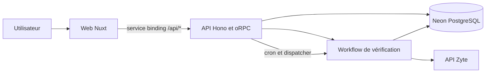

# Architecture

Ce document distingue le code présent de l’architecture visée. Les décisions détaillées, les garanties attendues et les travaux restants figurent dans [ALBA_PROGRESS.md](../ALBA_PROGRESS.md).

## État actuel

```text
Navigateur → Nuxt → /api/* → binding API → Hono/oRPC (santé)
API → binding PRICE_CHECK provisionné → Worker Workflows (squelette)
Neon B04 : schéma migré par Alchemy ; opérations SQL partagées testées via HTTP
```

Les trois Workers et le Workflow sont déployés sur le stage `dev`. Seul Nuxt possède une URL workers.dev ; API et Workflows restent internes. HTTP et oRPC ont été vérifiés via Nuxt. Une instance du squelette a terminé via l’API de gestion Cloudflare ; le déclenchement par le Worker API reste à valider en B07. Les routes de suivi restent à implémenter. Le package extraction contient désormais le client HTTP Zyte B05 ; son branchement au Workflow relève de B07. B04 ajoute les opérations SQL partagées testées sur Neon depuis Bun ; leur utilisation depuis les Workers reste à intégrer en B07/B10. Voir [les preuves et commandes](infrastructure.md).

## Applications

| Répertoire | Présent | Responsabilité visée |
| --- | --- | --- |
| `apps/web` | Nuxt 4, page provisoire et proxy serveur `/api/*`. | Interface, rendu serveur et transmission de `/api/*` vers l’API. |
| `apps/api` | Hono, `GET /health`, adaptation oRPC sous `/rpc/*` et serveur Bun local. | API, authentification, cron et dispatcher. |
| `apps/workflows` | Classe `PriceCheckWorkflow` et réponse HTTP 404. | Worker hébergeant le Workflow durable de vérification. |

Les trois applications correspondent aux Workers déclarés par Alchemy. Le cron et l’assemblage des traitements métier dans les Workers restent à implémenter.

## Packages

| Répertoire | Présent | Rôle visé |
| --- | --- | --- |
| `packages/api` | Routeur oRPC avec procédure `health` et type associé. | Procédures et types de l’API. |
| `packages/db` | Client Neon HTTP, schéma Drizzle B04 et migrations versionnées appliquées par Alchemy. | Schémas, accès aux données et migrations. |
| `packages/contracts` | Contrats Zod B03, types inférés et fixtures API/extraction/Workflow. | Schémas et types partagés sans code serveur. |
| `packages/auth` | Point d’entrée réservé. | Authentification. |
| `packages/tracking` | Finalisation idempotente et lecture du prix courant. | Logique métier commune aux applications serveur. |
| `packages/extraction` | Client HTTP Zyte et mapping B03, tests simulés. | Adaptateur d’extraction et normalisation des résultats. |
| `packages/config` | Configuration TypeScript stricte partagée. | Conventions techniques communes. |

Les workspaces consomment les points d’entrée TypeScript de leurs dépendances internes. Les applications assemblent les packages ; les secrets, accès SQL et implémentations serveur ne doivent pas être importés dans le code navigateur.

Les [contrats B03](contracts.md) définissent les entrées et réponses métier, le contexte d’offre, les montants décimaux, les observations et les erreurs classées. Leur validation est testée localement. L’adaptateur Zyte consomme ces contrats ; les routes métier et le Workflow restent à intégrer ; le squelette B02 conserve son ancien payload jusqu’à B07.

## Flux cible



Ce schéma est une **cible**, pas une représentation des connexions en fonctionnement. Le cron et le dispatcher doivent vivre dans le Worker API. Une vérification doit être persistée, puis traitée par une instance de Workflow ; les détails d’idempotence, de reprise et de budget sont définis dans le suivi du projet.

## Infrastructure et intégrations

- **Alchemy** : `alchemy`, `@alchemy.run/cloudflare`, `@alchemy.run/frontend-frameworks` et `@alchemy.run/neon` sont épinglés ensemble en `2.0.0-beta.87`. [`alchemy.run.ts`](../alchemy.run.ts) assemble les modules `infra/`, utilise l’état distant Cloudflare et isole les noms par stage. Le build Nitro Cloudflare, le premier déploiement dev et le redéploiement sont vérifiés.
- **Cloudflare** : bindings `API` (Web → API) et `PRICE_CHECK` (API → Workflow cross-worker) provisionnés. Pas de cron ; B04 déclare `DATABASE_URL` comme binding secret d’API et Workflows, vérifié en mode dev local, sans injection dans Web. Les routes de santé via Nuxt et le squelette Workflow sont exécutés sur Cloudflare ; les méthodes de création/consultation du binding API seront exercées en B07.
- **Neon et Drizzle** : `createDb` construit un client HTTP à partir d’une URL fournie par le serveur. Le schéma et les migrations Alchemy sont appliqués à un projet personnel distant ; finalisation via `db.batch` et contraintes sont testées réellement avec le driver HTTP. Le prix courant est dérivé de l’historique. Les transactions interactives exigeraient de réévaluer le transport ; Better Auth reste à valider. Voir [B04](database.md).
- **Zyte, Better Auth et interface métier** : non intégrés. Les variables proposées dans `.env.example` ne rendent pas ces fonctionnalités opérationnelles.

Références : [Alchemy Nuxt](https://alchemy.run/cloudflare/frontend/nuxt/), [Alchemy Workflows](https://alchemy.run/cloudflare/compute/add-a-workflow/), [Cloudflare Workflows](https://developers.cloudflare.com/workflows/), [oRPC avec Hono](https://orpc.dev/docs/adapters/hono) et [Drizzle avec Neon](https://orm.drizzle.team/docs/connect-neon).
