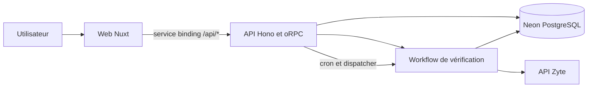

# Architecture

Ce document distingue le code présent de l’architecture visée. Les décisions détaillées, les garanties attendues et les travaux restants figurent dans [ALBA_PROGRESS.md](../ALBA_PROGRESS.md).

## État actuel

```text
Navigateur → Nuxt → /api/* → binding API → Hono/oRPC
API (déclencheur opérateur protégé) → binding PRICE_CHECK → Workflow durable B07
Workflow → Zyte HTTP → résultat durable → Neon (tentatives et finalisation atomique)
```

Ce parcours B07 est vérifié avec les Workers locaux d’Alchemy et Zyte/Neon réels, y compris une panne SQL injectée. Le déploiement cloud `dev` reste celui du squelette B02 ; aucun déploiement distant B07 n’a été effectué. Les routes de suivi, le cron et l’authentification restent à implémenter. Voir les [preuves B07](workflows.md) et [l’infrastructure](infrastructure.md).

## Applications

| Répertoire | Présent | Responsabilité visée |
| --- | --- | --- |
| `apps/web` | Nuxt 4, page provisoire et proxy serveur `/api/*`. | Interface, rendu serveur et transmission de `/api/*` vers l’API. |
| `apps/api` | Hono, santé HTTP/oRPC, déclencheur opérateur protégé `/internal/checks/*` et serveur Bun local. | API, authentification, cron et dispatcher. |
| `apps/workflows` | Workflow durable B07, extraction HTTP et finalisation Neon ; réponse HTTP 404. | Worker hébergeant le Workflow durable de vérification. |

Les trois applications correspondent aux Workers déclarés par Alchemy. Le cron, le dispatcher et les routes métier utilisateur restent à implémenter.

## Packages

| Répertoire | Présent | Rôle visé |
| --- | --- | --- |
| `packages/api` | Routeur oRPC avec procédure `health` et type associé. | Procédures et types de l’API. |
| `packages/db` | Client Neon HTTP, schéma Drizzle B04 et migrations versionnées appliquées par Alchemy. | Schémas, accès aux données et migrations. |
| `packages/contracts` | Contrats Zod B03, types inférés et fixtures API/extraction/Workflow. | Schémas et types partagés sans code serveur. |
| `packages/auth` | Point d’entrée réservé. | Authentification. |
| `packages/tracking` | Préparation atomique, journal des tentatives, finalisation idempotente et lecture du prix courant. | Logique métier commune aux applications serveur. |
| `packages/extraction` | Client HTTP Zyte et mapping B03, tests simulés. | Adaptateur d’extraction et normalisation des résultats. |
| `packages/config` | Configuration TypeScript stricte partagée. | Conventions techniques communes. |

Les workspaces consomment les points d’entrée TypeScript de leurs dépendances internes. Les applications assemblent les packages ; les secrets, accès SQL et implémentations serveur ne doivent pas être importés dans le code navigateur.

Le [benchmark B06](extraction-benchmark.md) est un outil Bun explicite, hors Workers et hors CI réseau. Il utilise l’adaptateur HTTP, des références indépendantes et l’API Stats Zyte pour mesurer qualité et coût ; les preuves synthétiques et marchandes sont séparées. Il ne modifie pas les contrats B03 ni le flux Workflow.

Les [contrats B03](contracts.md) définissent les entrées et réponses métier, le contexte d’offre, les montants décimaux, les observations et les erreurs classées. Leur validation est testée localement. L’adaptateur Zyte consomme ces contrats ; les routes métier restent à intégrer ; le Workflow B07 consomme le payload versionné.

## Flux cible



Ce schéma inclut le cron et les routes utilisateur encore **cibles** ; le parcours opérateur B07 est vérifié localement. Le cron et le dispatcher doivent vivre dans le Worker API. Une vérification doit être persistée, puis traitée par une instance de Workflow ; les détails d’idempotence, de reprise et de budget sont définis dans le suivi du projet.

## Infrastructure et intégrations

- **Alchemy** : `alchemy`, `@alchemy.run/cloudflare`, `@alchemy.run/frontend-frameworks` et `@alchemy.run/neon` sont épinglés ensemble en `2.0.0-beta.87`. [`alchemy.run.ts`](../alchemy.run.ts) assemble les modules `infra/`, utilise l’état distant Cloudflare et isole les noms par stage. Le build Nitro Cloudflare, le premier déploiement dev et le redéploiement sont vérifiés.
- **Cloudflare** : bindings `API` (Web → API) et `PRICE_CHECK` (API → Workflow cross-worker) provisionnés. Pas de cron ; B04 déclare `DATABASE_URL` comme binding secret d’API et Workflows, vérifié en mode dev local, sans injection dans Web. Les routes de santé via Nuxt et le squelette Workflow sont exécutés sur Cloudflare ; les méthodes de création/consultation du binding API sont exercées en B07 avec Alchemy local.
- **Neon et Drizzle** : `createDb` construit un client HTTP à partir d’une URL fournie par le serveur. Le schéma et les migrations Alchemy sont appliqués à un projet personnel distant ; finalisation via `db.batch` et contraintes sont testées réellement avec le driver HTTP. Le prix courant est dérivé de l’historique. Les transactions interactives exigeraient de réévaluer le transport ; Better Auth reste à valider. Voir [B04](database.md).
- **Zyte** : intégré au Workflow B07, avec activation explicite et hôtes autorisés. **Better Auth et interface métier** : non intégrés. Voir `.env.example` et [B07](workflows.md) pour les bindings serveur.

Références : [Alchemy Nuxt](https://alchemy.run/cloudflare/frontend/nuxt/), [Alchemy Workflows](https://alchemy.run/cloudflare/compute/add-a-workflow/), [Cloudflare Workflows](https://developers.cloudflare.com/workflows/), [oRPC avec Hono](https://orpc.dev/docs/adapters/hono) et [Drizzle avec Neon](https://orm.drizzle.team/docs/connect-neon).
