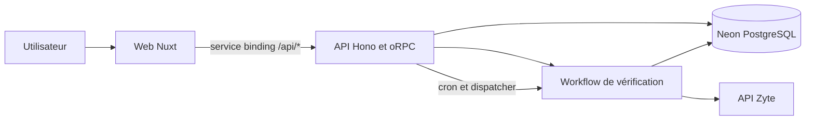

# Architecture

Ce document distingue le code présent de l’architecture visée. Les décisions détaillées, les garanties attendues et les travaux restants figurent dans [ALBA_PROGRESS.md](../ALBA_PROGRESS.md).

## État actuel

```text
Navigateur → Nuxt (page provisoire)
Outil local → API Hono → route de santé ou procédure oRPC de santé

Workflow : squelette isolé       Neon : fabrique de client seulement
Alchemy : déclaration Nuxt seule, non déployée
```

Il n’y a actuellement aucune liaison Web → API, aucun suivi produit, aucune connexion à une base, aucun appel Zyte et aucun déclenchement de Workflow. Le squelette de Workflow retourne `not-implemented` et ne possède pas de point de déclenchement public.

## Applications

| Répertoire | Présent | Responsabilité visée |
| --- | --- | --- |
| `apps/web` | Application Nuxt 4 et page provisoire. | Interface, rendu serveur et transmission de `/api/*` vers l’API. |
| `apps/api` | Hono, `GET /health`, adaptation oRPC sous `/rpc/*` et serveur Bun local. | API, authentification, cron et dispatcher. |
| `apps/workflows` | Classe `PriceCheckWorkflow` et réponse HTTP 404. | Worker hébergeant le Workflow durable de vérification. |

Les trois applications correspondent aux trois Workers visés ; leur provisionnement, leurs bindings et leur communication ne sont pas encore configurés ni validés.

## Packages

| Répertoire | Présent | Rôle visé |
| --- | --- | --- |
| `packages/api` | Routeur oRPC avec procédure `health` et type associé. | Procédures et types de l’API. |
| `packages/db` | Fabrique Drizzle utilisant le driver Neon HTTP, sans connexion à l’import. | Schémas, accès aux données et migrations. |
| `packages/contracts` | Point d’entrée réservé ; Zod est installé. | Schémas et types partagés sans code serveur. |
| `packages/auth` | Point d’entrée réservé. | Authentification. |
| `packages/tracking` | Point d’entrée réservé. | Logique métier commune aux applications serveur. |
| `packages/extraction` | Point d’entrée réservé. | Adaptateur d’extraction et normalisation des résultats. |
| `packages/config` | Configuration TypeScript stricte partagée. | Conventions techniques communes. |

Les workspaces consomment les points d’entrée TypeScript de leurs dépendances internes. Les applications assemblent les packages ; les secrets, accès SQL et implémentations serveur ne doivent pas être importés dans le code navigateur.

## Flux cible



Ce schéma est une **cible**, pas une représentation des connexions en fonctionnement. Le cron et le dispatcher doivent vivre dans le Worker API. Une vérification doit être persistée, puis traitée par une instance de Workflow ; les détails d’idempotence, de reprise et de budget sont définis dans le suivi du projet.

## Infrastructure et intégrations

- **Alchemy** : `alchemy`, `@alchemy.run/cloudflare` et `@alchemy.run/frontend-frameworks` sont épinglés ensemble en `2.0.0-beta.87`. [`alchemy.run.ts`](../alchemy.run.ts) ne déclare que le site Nuxt. La stack, l’état et le build Cloudflare n’ont pas été validés par déploiement. Ne pas mélanger les API de la génération 2 avec celles d’Alchemy v1.
- **Cloudflare** : les Workers API et Workflow, le cron, les service bindings, les secrets et les environnements restent à configurer. Les bundles locaux ne sont pas une validation du runtime.
- **Neon et Drizzle** : `createDb` construit un client HTTP à partir d’une URL fournie par le serveur. Aucune connexion, migration ou transaction n’a été testée. Les transactions interactives exigeraient de réévaluer le transport.
- **Zyte, Better Auth et interface métier** : non intégrés. Les variables proposées dans `.env.example` ne rendent pas ces fonctionnalités opérationnelles.

Références : [Alchemy Nuxt](https://alchemy.run/cloudflare/frontend/nuxt/), [Alchemy Workflows](https://alchemy.run/cloudflare/compute/add-a-workflow/), [Cloudflare Workflows](https://developers.cloudflare.com/workflows/), [oRPC avec Hono](https://orpc.dev/docs/adapters/hono) et [Drizzle avec Neon](https://orm.drizzle.team/docs/connect-neon).
